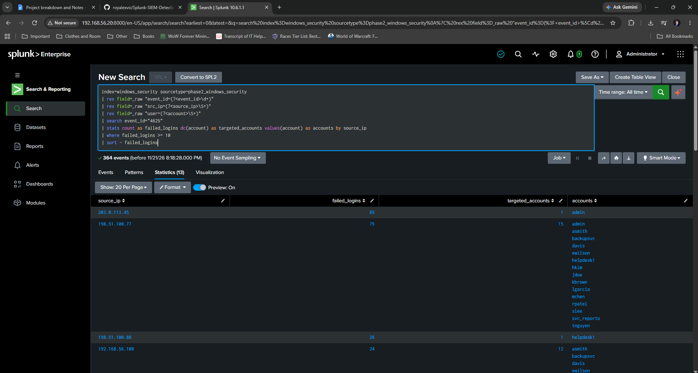
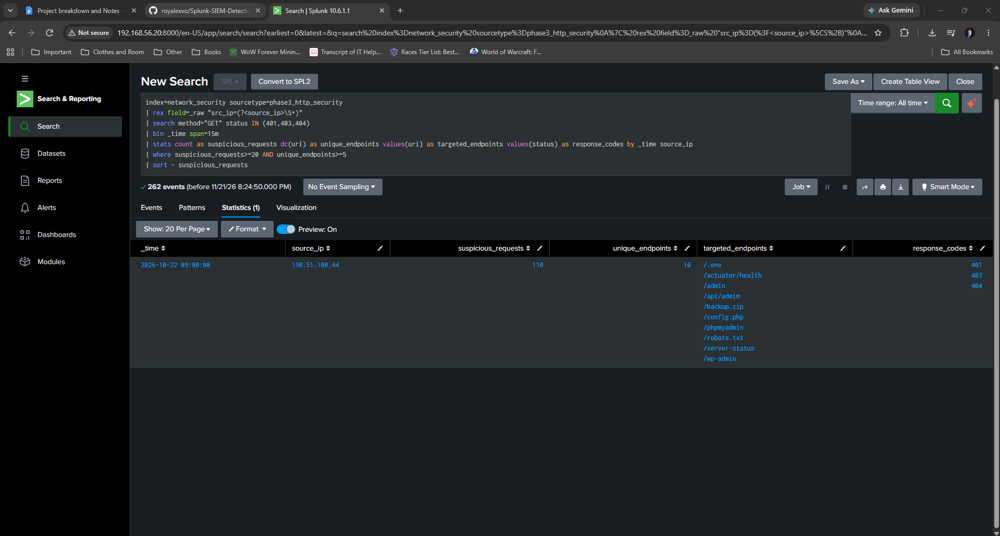
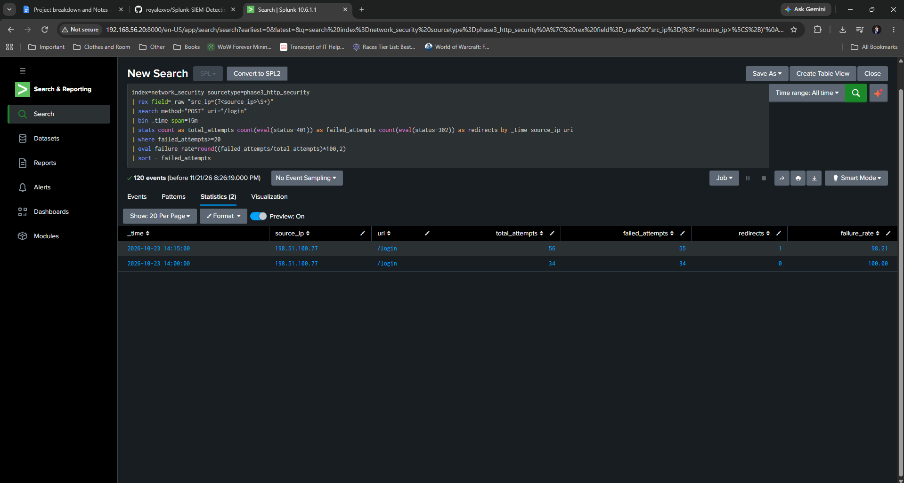
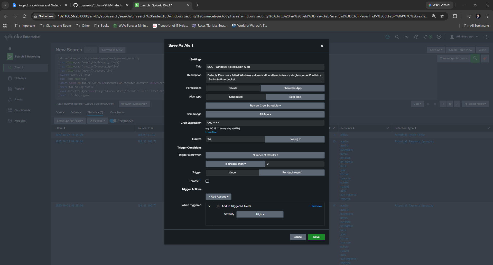
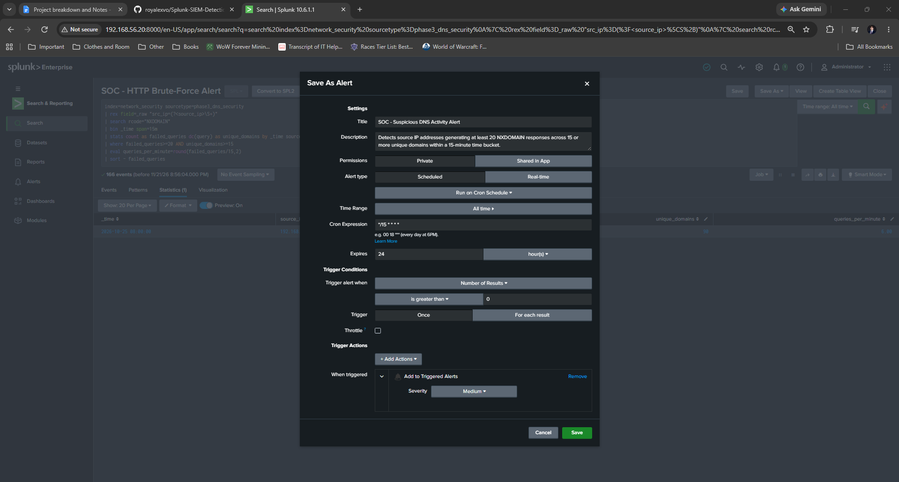
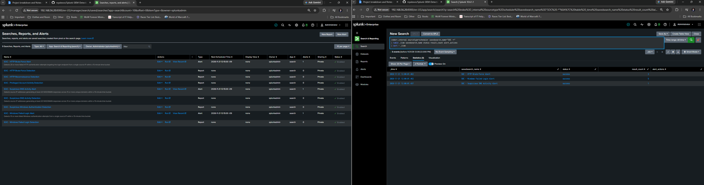

<h1>Splunk SOAR & Automated Incident Response</h1>

<h2>Description</h2>

This phase focuses on implementing Security Orchestration, Automation, and Response (SOAR) workflows to support security investigations and incident response. The objective is to integrate security detections developed in previous phases with automated investigation, enrichment, and response actions.

Building on the security dashboards and detections developed in Phases 4 and 5, this phase introduces SOAR platform configuration, automated playbooks, alert enrichment, and controlled remediation workflows. Emphasis is placed on validating security alerts, incorporating analyst approval, and reducing the risk of unintended actions caused by false positives.

 The following topics will be covered in this phase:

- <b>SOAR fundamentals and environment setup</b>
- <b>SOAR platform installation and configuration</b>
- <b>Splunk SIEM and SOAR integration</b>
- <b>Security alert ingestion and enrichment</b>
- <b>Automated alert triage and investigation</b>
- <b>Windows authentication investigation playbooks</b>
- <b>HTTP security investigation playbooks</b>
- <b>DNS security investigation playbooks</b>
- <b>Analyst approval workflows</b>
- <b>Controlled remediation and response actions</b>
- <b>Workflow testing and validation</b>
- <b>False-positive analysis and safety controls</b>

This phase demonstrates how SOAR can extend SIEM monitoring capabilities by automating repetitive investigation tasks, coordinating response actions, and supporting more efficient Security Operations Center (SOC) workflows.

 

<h2>Languages and Utilities Used</h2>

- <b>Splunk Enterprise 10.6.1.1</b>
- <b>Splunk Processing Language (SPL)</b>
- <b>Splunk Security Alerts</b>
- <b>SOAR Platform (To Be Determined)</b>
- <b>Python (If Required)</b>
- <b>REST APIs and Webhooks (If Supported)</b>

<h2>Environments Used</h2>

- <b>Host Operating System: Windows 11</b>
- <b>Virtualization Platform: Oracle VirtualBox</b>
- <b>Splunk SIEM Server: Ubuntu Server 24.04.5 LTS</b>
- <b>Splunk Server IP Address: 192.168.56.20</b>
- <b>Windows Security Index: windows_security</b>
- <b>Network Security Index: network_security</b>
- <b>SOAR Environment: To Be Determined</b>

<h2>Program walk-through:</h2>

<b>Step 1 – Review SOAR Fundamentals and Prepare the Environment</b>  
Review the fundamental concepts of Security Orchestration, Automation, and Response, including automated playbooks, alert enrichment, and incident response workflows. Select an appropriate SOAR platform and prepare the environment by reviewing system requirements, network connectivity, and integration capabilities: 

<b>Step 2 – Install and Configure the SOAR Platform</b>  
Install and configure the selected SOAR platform within the lab environment. Complete the initial administrative setup, verify access to the management interface, and confirm that the platform is ready to support automated security workflows: 

<b>Step 3 – Integrate Splunk SIEM with the SOAR Platform</b>  
Configure communication between Splunk Enterprise and the SOAR platform using a supported integration method. Verify connectivity and confirm that security alerts or detection results can be transferred between the SIEM and automation environments: 

<b>Step 4 – Configure Security Alert Ingestion and Enrichment</b>  
Configure the SOAR platform to receive security alerts generated by Splunk detection searches. Develop an enrichment workflow to extract relevant information, including source IP addresses, affected user accounts, timestamps, detection names, and supporting security events: 

<b>Step 5 – Develop a Windows Authentication Investigation Playbook</b>  
Create an automated investigation playbook for suspicious Windows authentication activity. Analyze failed login attempts, affected accounts, originating IP addresses, and subsequent successful logins to identify potentially compromised accounts and suspicious authentication patterns: 

<b>Step 6 – Develop an HTTP Security Investigation Playbook</b>  
Create an automated investigation playbook for suspicious HTTP activity identified through Splunk alerts. Examine source IP addresses, requested endpoints, HTTP methods, response status codes, and request frequency to investigate potential web reconnaissance and repeated authentication attempts: 

<b>Step 7 – Develop a DNS Security Investigation Playbook</b>  
Create an automated investigation playbook for suspicious DNS activity, including excessive NXDOMAIN responses and unusual domain query patterns. Analyze source IP addresses, queried domains, and query frequency to identify potentially automated DNS behavior: 

<b>Step 8 – Configure Automated Alert Triage</b>  
Develop an automated triage workflow to classify incoming security alerts based on detection type, available evidence, and predefined investigation criteria. Use the results to prioritize suspicious activity and determine whether additional analyst review or response actions are required: 

<b>Step 9 – Implement Analyst Approval Workflows</b>  
Configure an analyst approval process requiring authorization before potentially disruptive response actions are performed. Establish approval conditions for suspicious accounts, source IP addresses, and other security indicators to ensure appropriate human oversight during incident response: 

<b>Step 10 – Develop a Controlled Remediation Workflow</b>  
Create a controlled remediation workflow that demonstrates how validated security alerts can initiate response actions. Use simulated or isolated lab resources to test procedures such as blocking suspicious IP addresses or disabling test accounts while incorporating analyst approval and safety controls: 

<b>Step 11 – Test and Validate SOAR Playbooks</b>  
Test the developed SOAR playbooks using simulated security alerts and previously identified suspicious activity. Verify that alerts are ingested correctly, enrichment actions execute successfully, investigation results are recorded, and response workflows follow their configured conditions: 

<b>Step 12 – Evaluate False Positives and Workflow Safety</b>  
Review the automated workflows to identify potential false positives, unnecessary response actions, and configuration issues. Refine playbook conditions, approval requirements, and remediation safeguards to reduce the risk of disrupting legitimate activity: 

<b>Step 13 – Validate Automated Incident Response and Complete Phase 6</b>  
Perform a final review of the SOAR environment, Splunk integration, automated investigation playbooks, alert enrichment procedures, and controlled response workflows. Verify that the completed automation processes function as intended and document how the environment supports security investigations and incident response operations: 

