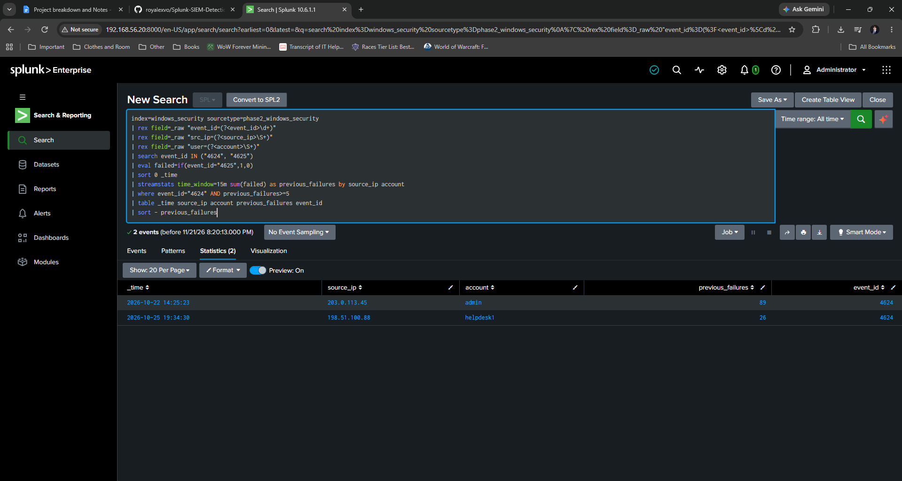
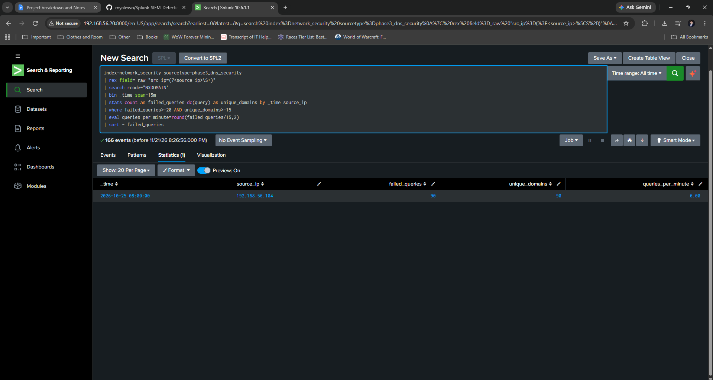
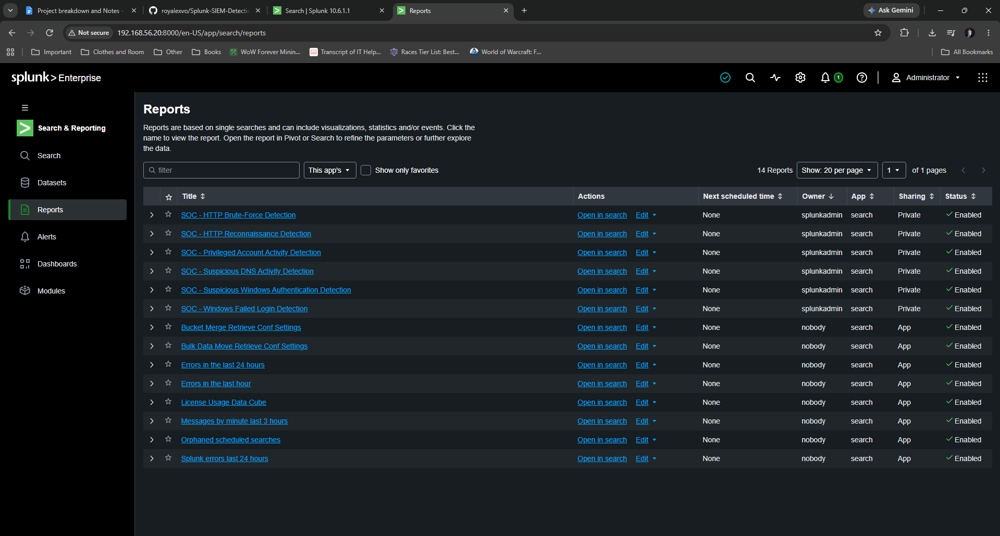
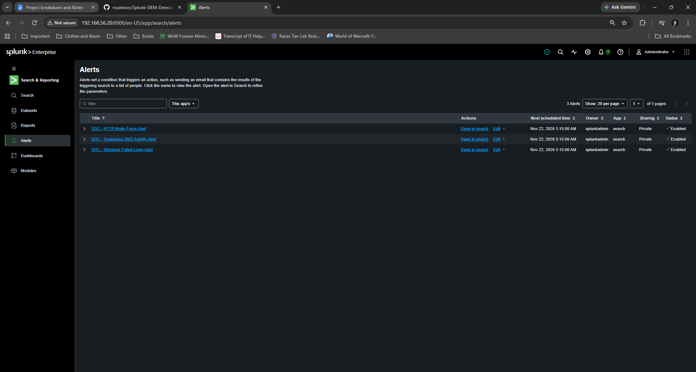
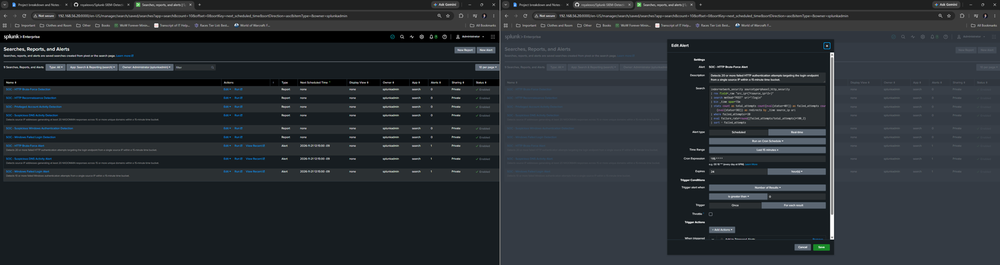

<h1>Splunk Security Detections & Automated Alerting</h1>

<h2>Description</h2>

This phase focused on developing security detection searches and configuring automated alerts within Splunk Enterprise. The objective was to identify suspicious Windows authentication activity, privileged account activity, HTTP reconnaissance, HTTP brute-force attempts, and abnormal DNS behavior using Splunk Processing Language (SPL).

Building on the security monitoring dashboard developed in Phase 4, reusable detection searches were created using event filtering, statistical aggregation, detection thresholds, severity classification, and time-based analysis. Scheduled security alerts were configured and validated using previously ingested simulated security events.

 The following tasks were completed in this phase:

- <b>Windows failed login detection</b>
- <b>Suspicious Windows authentication detection</b>
- <b>Potential brute-force and password spraying detection</b>
- <b>Privileged account activity detection</b>
- <b>Security event severity classification</b>
- <b>HTTP reconnaissance detection</b>
- <b>HTTP brute-force detection</b>
- <b>Suspicious DNS activity detection</b>
- <b>Detection threshold configuration</b>
- <b>Reusable security detection searches</b>
- <b>Scheduled security alert configuration</b>
- <b>Alert execution and trigger validation</b>
- <b>Security detection and alert optimization</b>

This phase demonstrated how Splunk can identify suspicious activity through customized detection searches and automate security notifications to support Security Operations Center (SOC) monitoring and investigations.

 

<h2>Languages and Utilities Used</h2>

- <b>Splunk Enterprise 10.6.1.1</b>
- <b>Splunk Processing Language (SPL)</b>
- <b>Splunk Search & Reporting</b>
- <b>Splunk Security Alerts</b>
- <b>Regular Expressions (Regex)</b>
- <b>Cron Scheduling</b>
- <b>Splunk Internal Scheduler Logs</b>

<h2>Environments Used</h2>

- <b>Host Operating System: Windows 11</b>
- <b>Virtualization Platform: Oracle VirtualBox</b>
- <b>Splunk SIEM Server: Ubuntu Server 24.04.5 LTS</b>
- <b>Splunk Server IP Address: 192.168.56.20</b>
- <b>Windows Security Index: windows_security</b>
- <b>Network Security Index: network_security</b>
- <b>Windows Security Events: 1,500</b>
- <b>HTTP Security Events: 2,000</b>
- <b>DNS Security Events: 2,000</b>
- <b>Total Simulated Security Events: 5,500</b>

<h2>Program walk-through:</h2>

<b>Step 1 – Develop a Windows Failed Login Detection Query</b>  
Developed an SPL detection query to identify repeated Windows authentication failures using Event ID 4625. Grouped failed authentication attempts by source IP address and 15-minute time buckets to identify suspicious login activity that exceeded the configured detection threshold: 

<b>Step 2 – Develop a Suspicious Windows Authentication Detection Query</b>  
Developed a detection query to investigate suspicious Windows authentication patterns by analyzing failed login attempts, source IP addresses, and targeted user accounts. Classified activity as potential brute-force or password spraying attempts based on the number of accounts targeted during the observed authentication activity: 

<b>Step 3 – Develop a Privileged Account Activity Detection Query</b>  
Developed an SPL detection query to identify privileged account activity using Windows Event IDs 4672, 4720, 4724, and 4728. Classified security events by activity type and assigned severity levels based on their potential security impact. Sorted the results by severity to prioritize account creation, security group membership changes, and password reset attempts for investigation: 

<b>Step 4 – Develop an HTTP Reconnaissance Detection Query</b>  
Developed an HTTP reconnaissance detection query to identify source IP addresses generating at least 20 suspicious GET requests across five or more unique endpoints within a 15-minute time bucket. Analyzed HTTP response codes 401, 403, and 404 to identify potential reconnaissance activity. The detection identified 110 suspicious requests targeting 10 unique endpoints from source IP address 198.51.100.44: 

<b>Step 5 – Develop an HTTP Brute-Force Detection Query</b>  
Developed an HTTP brute-force detection query to identify repeated authentication failures targeting the /login endpoint. Configured a threshold of 20 or more failed authentication attempts from a single source IP address within a 15-minute time bucket. The detection identified 90 authentication requests from source IP address 198.51.100.77, including 89 HTTP 401 responses and one HTTP 302 redirect across two detection windows: 

<b>Step 6 – Develop a Suspicious DNS Activity Detection Query</b>  
Developed a DNS detection query to identify source IP addresses generating at least 20 NXDOMAIN responses across 15 or more unique domains within a 15-minute time bucket. Calculated the average number of failed DNS queries per minute to evaluate suspicious query frequency. The detection identified 90 failed DNS queries across 90 unique domains from source IP address 192.168.56.104, averaging six failed queries per minute: 

<b>Step 7 – Save and Organize Security Detection Searches</b>  
Saved six completed security detection queries as reusable Splunk reports. Applied consistent SOC naming conventions to organize Windows authentication, privileged account activity, HTTP reconnaissance, HTTP brute-force, and suspicious DNS detections. Verified that all six detection searches were available through the Splunk Reports interface: 

<b>Step 8 – Configure a Windows Failed Login Alert</b>  
Created a scheduled security alert using the Windows failed login detection query. Configured the alert to execute every 15 minutes using a cron expression and trigger when the detection returned one or more results. Assigned a high severity level, configured a 24-hour expiration period, and enabled the Add to Triggered Alerts action: 

<b>Step 9 – Configure an HTTP Brute-Force Alert</b>  
Created a scheduled HTTP brute-force alert to identify source IP addresses exceeding the configured authentication failure threshold. Configured the alert to execute every 15 minutes, trigger when one or more detection results were returned, and record triggered alerts with a high severity level and a 24-hour expiration period: 

<b>Step 10 – Configure a Suspicious DNS Activity Alert</b>  
Created a scheduled DNS security alert using the suspicious DNS activity detection query. Configured the alert to execute every 15 minutes and trigger when one or more detection results were returned. Assigned a medium severity level, configured a 24-hour expiration period, and enabled the Add to Triggered Alerts action: 

<b>Step 11 – Review and Verify Scheduled Security Alerts</b>  
Reviewed the Splunk Alerts interface to verify that all three scheduled security alerts were successfully created and enabled. Confirmed the alert names, scheduling configuration, ownership, and operational status for the Windows failed login, HTTP brute-force, and suspicious DNS activity alerts: 

<b>Step 12 – Test and Validate Security Alert Execution</b>  
Validated scheduled security alert execution using Splunk internal scheduler logs and previously ingested simulated security events. Confirmed successful execution of all three scheduled alerts, with five Windows failed login detection results, two HTTP brute-force detection results, and one suspicious DNS activity detection result. Verified that each alert recorded a triggered instance within the Splunk Searches, Reports, and Alerts interface: 

<b>Step 13 – Final Detection Review and Validation</b>  
Performed a final review of the six saved security detection searches and three scheduled security alerts. Updated the scheduled alert search windows from All time to Last 15 minutes to prevent repeated detection of previously identified historical events. Retained the 15-minute execution schedule and verified that the updated alert configurations were saved for future security monitoring and SOAR integration: 

