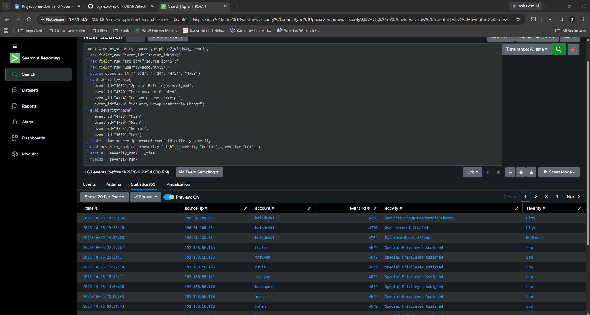
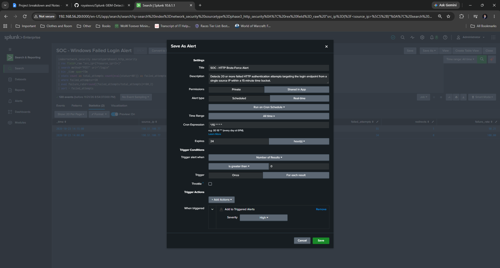

<h1>Splunk Security Detections & Automated Alerting</h1>

<h2>Description</h2>

This phase focused on developing security detection queries, reusable saved searches, and automated alerts within Splunk Enterprise. The objective was to transform previously collected Windows, HTTP, and DNS security logs into actionable detections that support security monitoring, threat identification, and incident investigation.

Building on the security investigations and monitoring dashboards developed in previous phases, this phase introduced detection logic, event correlation, threshold-based alerting, severity classifications, and scheduled search execution. Detection queries and alerts were validated against historical simulated security events to verify their effectiveness.

 The following topics were covered in this phase:

- <b>Security detection development using SPL</b>
- <b>Windows brute-force and password spraying detection</b>
- <b>Suspicious Windows authentication correlation</b>
- <b>Privileged account activity monitoring</b>
- <b>HTTP reconnaissance detection</b>
- <b>HTTP brute-force detection</b>
- <b>Suspicious DNS and potential DGA activity detection</b>
- <b>Reusable saved searches</b>
- <b>Automated security alert configuration</b>
- <b>Detection thresholds and severity classifications</b>
- <b>Scheduled search execution</b>
- <b>Security alert testing and validation</b>
- <b>Alert tuning and historical event duplication prevention</b>

This phase demonstrated how SIEM security data can be transformed into actionable detections and automated alerts to support Security Operations Center (SOC) monitoring and investigation workflows while establishing a foundation for subsequent security automation.

 

<h2>Languages and Utilities Used</h2>

- <b>Splunk Enterprise 10.6.1.1</b>
- <b>Splunk Processing Language (SPL)</b>
- <b>Splunk Search & Reporting</b>
- <b>Splunk Saved Searches</b>
- <b>Splunk Security Alerts</b>
- <b>Splunk Internal Scheduler Logs</b>
- <b>Regular Expressions (Regex)</b>
- <b>Cron Expressions</b>

<h2>Environments Used</h2>

- <b>Host Operating System: Windows 11</b>
- <b>Virtualization Platform: Oracle VirtualBox</b>
- <b>Splunk SIEM Server: Ubuntu Server 24.04.5 LTS</b>
- <b>Splunk Server IP Address: 192.168.56.20</b>
- <b>Windows Security Index: windows_security</b>
- <b>Network Security Index: network_security</b>
- <b>Splunk Internal Index: _internal</b>

<h2>Program walk-through:</h2>

<b>Step 1 – Develop a Windows Failed Login Detection</b>  
Developed an SPL detection query using Windows Security Event ID 4625 to identify repeated failed authentication attempts. Extracted source IP addresses and user accounts, calculated failed login counts, and identified the number of unique accounts targeted by each source. Distinguished activity consistent with potential brute-force attacks from activity consistent with password spraying: 

<b>Step 2 – Develop a Suspicious Windows Authentication Detection</b>  
Developed an SPL correlation query using Windows Security Event IDs 4624 and 4625 to identify successful authentication events following repeated failed login attempts. Used a rolling 15-minute time window to correlate authentication activity by source IP address and user account. Identified two suspicious authentication events involving the admin and helpdesk1 accounts, following 89 and 26 failed login attempts respectively: 

<b>Step 3 – Develop a Privileged Account Activity Detection</b>  
Developed an SPL detection query to monitor Windows security events associated with special privilege assignments, account creation, password reset attempts, and security group membership changes. Assigned severity classifications based on event type and prioritized higher-severity activity. Identified 63 relevant security events, including three noteworthy account management events associated with the helpdesk1 account and source IP address 198.51.100.88: 

<b>Step 4 – Develop an HTTP Reconnaissance Detection</b>  
Developed an SPL detection query to identify potential automated web reconnaissance by analyzing HTTP GET requests associated with 401, 403, and 404 response codes. Established a detection threshold of at least 20 suspicious requests targeting five or more unique endpoints within a 15-minute time bucket. Identified source IP address 198.51.100.44 generating 110 suspicious requests across 10 unique endpoints: 

<b>Step 5 – Develop an HTTP Brute-Force Detection</b>  
Developed an SPL detection query to identify repeated HTTP POST requests targeting the /login endpoint. Analyzed failed authentication responses, total login attempts, HTTP redirects, and authentication failure rates. Established a detection threshold of at least 20 failed login requests within a 15-minute time bucket. Identified two detection results associated with source IP address 198.51.100.77, totaling 90 login attempts, 89 failed responses, and one HTTP redirect. The redirect was treated as an investigation indicator rather than confirmation of successful authentication: 

<b>Step 6 – Develop a Suspicious DNS Activity Detection</b>  
Developed an SPL detection query to identify potentially automated DNS activity by analyzing excessive NXDOMAIN responses, unique domain counts, and query frequency. Established a detection threshold of at least 20 failed DNS queries across 15 or more unique domains within a 15-minute time bucket. Identified source IP address 192.168.56.104 generating 90 failed queries across 90 unique domains at an average rate of six queries per minute, representing activity consistent with potential Domain Generation Algorithm (DGA) behavior: 

<b>Step 7 – Save and Organize Security Detection Searches</b>  
Saved all six completed SPL detection queries as reusable reports within Splunk Enterprise. Applied consistent naming conventions to organize Windows authentication, privileged account activity, HTTP reconnaissance, HTTP brute-force, and suspicious DNS detections. Verified that the saved searches were available through the Splunk Reports interface for future investigations and alert configuration: 

<b>Step 8 – Configure a Windows Failed Login Security Alert</b>  
Configured a scheduled security alert to detect 10 or more failed Windows authentication attempts originating from a single source IP address within a 15-minute time bucket. Incorporated unique targeted account counts to distinguish potential brute-force and password spraying activity. Configured the alert to execute every 15 minutes using a cron expression, trigger when detection results were returned, and record triggered alerts with a High severity classification. Temporarily configured the search to analyze historical events for validation purposes: 

<b>Step 9 – Configure an HTTP Brute-Force Security Alert</b>  
Configured a scheduled security alert to detect 20 or more failed HTTP authentication attempts targeting the /login endpoint from a single source IP address within a 15-minute time bucket. Established a 15-minute execution schedule, a result-based trigger condition, and a High severity classification. Configured the alert to record triggered events and temporarily search historical HTTP security logs for testing and validation: 

<b>Step 10 – Configure a Suspicious DNS Activity Security Alert</b>  
Configured a scheduled security alert to detect source IP addresses generating at least 20 NXDOMAIN responses across 15 or more unique domains within a 15-minute time bucket. Established a 15-minute execution schedule and configured the alert to trigger when detection results were returned. Assigned a Medium severity classification because excessive failed DNS queries represent suspicious activity but do not independently confirm malware infection: 

<b>Step 11 – Review Alert Thresholds and Scheduling</b>  
Reviewed the three configured security alerts to verify their enabled status, detection thresholds, scheduling configurations, trigger conditions, severity classifications, and expiration settings. Confirmed that each alert was scheduled to execute every 15 minutes using the cron expression */15 * * * *, trigger once per qualifying execution, and retain triggered alert records for 24 hours: 

<b>Step 12 – Test and Validate Security Alerts</b>  
Validated automated security alert execution by querying Splunk internal scheduler logs through the _internal index. Confirmed that all three scheduled detection searches executed successfully and returned the expected results, including five Windows failed login detections, two HTTP brute-force detections, and one suspicious DNS detection. Independently verified that each configured security alert generated a recorded alert through the Searches, Reports, and Alerts management interface. Validation was performed using historical simulated security events: 

<b>Step 13 – Perform Final Detection Review and Complete Phase 5</b>  
Performed a final review of all six saved security detection searches and three scheduled security alerts. Verified that all nine configurations were saved and enabled. Following successful historical alert validation, updated the scheduled alert search windows to the last 15 minutes to prevent repeated alert generation from the same historical security events. Retained the existing detection thresholds, severity classifications, and scheduling configurations. Prepared the Splunk environment for future security monitoring and subsequent SOAR integration: 

<h2>Phase 5 Results</h2>

- <b>Reusable security detection searches developed:</b> 6
- <b>Scheduled security alerts configured:</b> 3
- <b>Successful scheduled alert search executions validated:</b> 3
- <b>Windows failed login detection results:</b> 5
- <b>HTTP brute-force detection results:</b> 2
- <b>Suspicious DNS detection results:</b> 1
- <b>Total validated scheduled detection results:</b> 8
- <b>Recorded triggered alerts during validation:</b> 3
- <b>Alert execution frequency:</b> Every 15 minutes

<h2>Conclusion</h2>

This phase successfully implemented reusable security detections and automated alerting within Splunk Enterprise. Windows authentication events, privileged account activity, HTTP requests, and DNS queries were analyzed using SPL to identify suspicious security patterns and establish appropriate detection thresholds.

Scheduled security alerts were configured and validated against historical simulated security events, demonstrating successful automated search execution and alert generation. Alert search windows were subsequently configured for ongoing monitoring to reduce repeated alerting on historical events.

Live-event alerting remains untested because the lab utilized historical simulated security logs. The completed detection and alerting capabilities establish a foundation for Phase 6, which will focus on Security Orchestration, Automation, and Response (SOAR), automated investigation workflows, alert enrichment, analyst approval, and controlled incident response actions.
